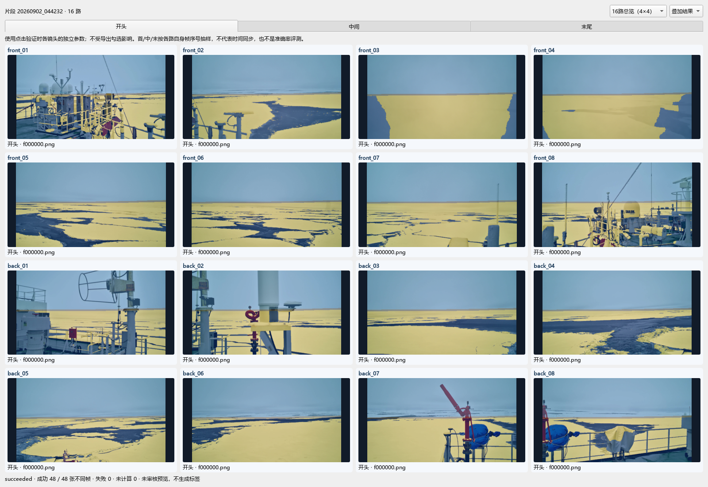
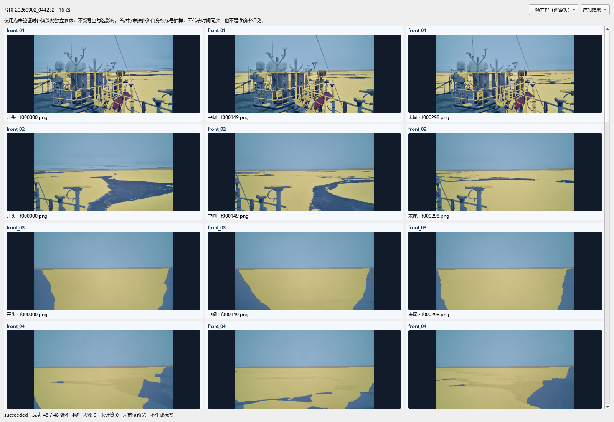
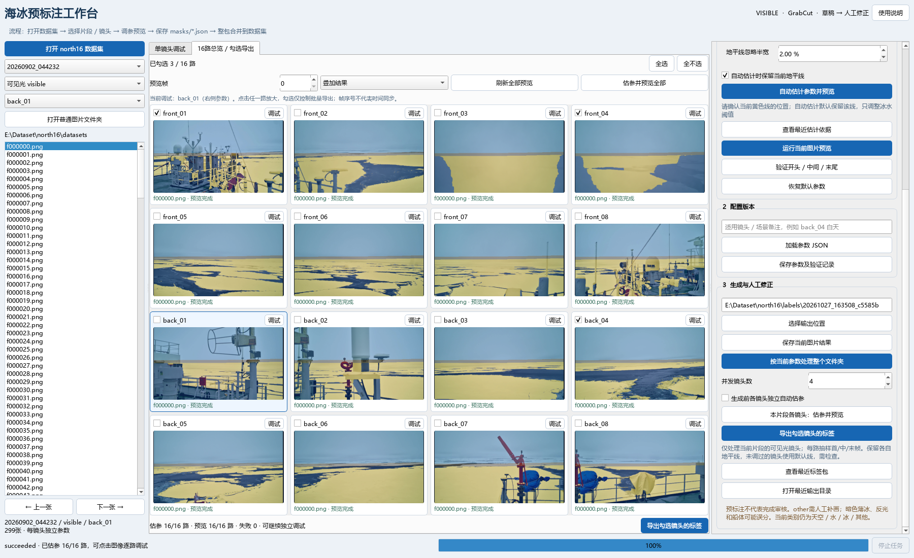

# 0.12.0：默认两点直线与镜头参数复用

新窗口、新镜头、恢复默认和不提供配置的估参/CLI预标注默认采用两点直线，保留左右端点高度0.475/0.455，忽略半宽仍为1.00%。手动加载旧版多点折线JSON会保留其控制点，仍可主动切换多点折线。

右侧“2 配置版本”提供：

1. **保存参数及验证记录**：将当前参数保存为JSON及验证回执，同时复制为窗口内参数快照。结构化工作区保存在工作区parameters；旧datasets模式保存在标签包parameters，普通图片文件夹由用户选择路径。
2. **复制当前参数**：只创建一份窗口内快照，适合先试用；复制后继续调整原镜头不会改变快照。
3. **粘贴到当前镜头**：切换镜头后直接粘贴快照，替换完整分割参数，包括地平线、忽略半宽、海面模式、工作宽度、冰水阈值、迭代、边界核和随机种子。粘贴后可独立微调。
4. **当前参数应用到本片段全部镜头**：使用右侧当前参数替换当前片段所有已加载可见光镜头参数，包括未勾选镜头。与剪贴快照不同，该按钮总是使用当前正在调试的参数；其他片段及infrared保持各自参数。

复制缓冲仅在当前窗口有效；跨次启动使用保存/加载参数JSON，然后可再次应用全部。参数操作不生成/覆盖标签，不复制源镜头的估参依据、验证记录、预览、天气或备注。粘贴和应用全部会关闭“生成前各镜头独立自动估参”，确保批量生成使用复用后的参数；如需重新估参可主动勾选。参数改变后预览及首中末验证会标记过期，请刷新后检查。镜头采用独立参数副本，一路后续微调不影响其他路。

示例：调试back_04 → 保存参数及验证记录 → 切换back_03 → 粘贴到当前镜头 → 预览并微调。统一起点：调试一个镜头 → 当前参数应用到本片段全部镜头 → 刷新全部预览 → 验证16路首/中/末 → 逐路微调 → 保存标签。镜头高度、遮挡及光照可能不同，复用只提供初始参数。

# 0.11.0：独立标注工作区

启动：`north16 annotation gui --root <annotation目录>`。打开后输出位置固定为工作区根目录；单张/批量保存进入同镜头masks/*.json，图片保留在images。16路勾选后点击“保存勾选镜头的标签”；已有标签拒绝覆盖。点击“导出图片＋标签整包”选择父目录，交付当前片段勾选镜头全部图片及已存在标签；报告未标注数。CLI可交付多片段/双模态；红外浏览时界面交付当前红外镜头。工作区导出停止后不会发布半成品包。普通datasets继续使用历史外置标签包行为。详见 [工作流](WORKFLOW.md)。下文旧版“导出勾选镜头”在工作区对应就地保存，参数、预览和验证操作一致。

# 0.9.1：两点直线地平线

单镜头调试页原图上方新增地平线类型选项“两点直线 / 多点折线”。直线模式仅保留左右边缘两个黄色端点，上下拖动任一端点即可调整高度和倾斜，忽略半宽仍默认1.00%。适合画面中的地平线近似直线的情况；明显镜头畸变时可用多点折线。

由折线切到直线时保留两端位置、移除中间点；切回折线会沿当前直线补为5点。修改后重新预览、验证。每个镜头独立保存当前控制点，切换镜头或加载配置会自动显示对应类型；主动自动估计地平线时也保留两点模式。原有多点配置按原样加载。

保存参数和导出JSON仍记录horizon_normalized_xy，两点模式记录两个坐标；单帧预览、16路首中末验证和批量导出读取同一组参数。

# 0.9.0：1.00%默认半宽与16路三帧验证

地平线忽略半宽默认1.00%，表示线上下各图高的1%，总忽略带约2%。新窗口、恢复默认以及未配置镜头均使用此值；加载已保存的2.00%等配置时保留原值，不改写旧参数或标签。

结构化数据集的右侧“验证16路：开头 / 中间 / 末尾”和总览工具栏“验证首 / 中 / 末”共用同一入口：读取当前片段全部visible镜头，用每路自己的当前参数分别计算其首帧、中帧和末帧。无需勾选导出；验证不重新估参、不生成标签。

验证窗口支持两种布局：

- **16路总览（4×4）**：通过上方“开头 / 中间 / 末尾”切换，同屏显示16个镜头对应位置的结果。
- **三帧并排（逐镜头）**：每行一个镜头，三列分别为开头、中间、末尾，可上下滚动检查所有镜头。

两种布局都能切换叠加结果、彩色掩码和原图，显示实际帧名。帧数不足3时重复位置不重复计算；短流会显示实际重复帧名。失败帧单独提示，停止后已完成缩略图保留，未计算位置明确标记。该界面是抽样检查，不计算准确率，也不证明时间同步。

验证窗口可保持打开继续调参；参数变化会标记对应镜头的旧验证结果。重新点击验证可刷新。完整成功的抽样回执按数据集、片段、镜头和参数哈希保留，保存参数时写入其验证记录；不把其他镜头相同参数哈希的记录混入。

普通图片文件夹仍使用原单路首/中/末验证；红外不启用当前可见光分割验证。





# 0.8.0：16路总览、独立调试和勾选导出

1. 打开结构化数据集，选择片段和visible，切换中间的“16路总览 / 勾选导出”。首次打开此页自动预览全部镜头，不写标签文件。
2. 点击“估参并预览全部”，各路按自己的首/中/末帧估参，再显示当前预览帧的结果。也可用“刷新全部预览”直接查看已有参数的结果。
3. 总览按front和back排成4×4，支持叠加结果、彩色掩码、原图。每卡显示镜头名、实际帧名、预览状态和导出复选框。预览帧按序号选择，各路长度不足时使用末帧，不代表已完成时间同步。
4. 点击图像或“调试”进入该镜头的单路调试页，右侧仅修改当前镜头的参数。黄色地平线、全冰/全水、亮度阈值仍独立设置；点击当前图片预览后，总览中对应结果同时更新。参数或预览帧改变后旧结果标记为待刷新。
5. 勾选要导出的镜头，点击“导出勾选镜头的标签”。勾选不影响其他镜头预览；全不选时禁用导出。默认使用调试后的参数，不重新自动估计；确需重新估参可主动勾选右侧选项。
6. 批量导出处理选中镜头的整个片段，输出masks/*.json。当前包若已有标签，自动创建同父目录的新批次，确保这次导出只包含本次选中的镜头；旧包保留。单张保存/当前文件夹处理仍明确针对当前镜头。

勾选状态在当前窗口按数据集和片段独立记忆。切换片段后预览缓存重建，避免显示其他片段的结果；配置仍按镜头分别保存。红外和普通文件夹不启用16路总览分割。



当前规范见[多镜头工作流](MULTICAMERA.md)和[模块与目录](MODULES.md)。下方旧版本drafts/projects/PNG说明仅供历史接口追溯。

# 0.6.0 标注界面

当前规范以[初始化、相机、分割模块](MODULES.md)为准：初始化不抽帧、不创建masks；相机模块独立处理；分割默认导出同结构masks/*.json；整包合并后Dataset直接读取。下方保留旧版接口与历史实现说明，仅用于兼容和追溯。

# North16结构化数据集标注界面

0.4.4输出规则见[标注工作区规范](ANNOTATIONS.md)：drafts与projects共用批次编号，已存在的编辑工程不会覆盖；新版工程回读无需指定输出，默认保存到corrected。README.txt与index.txt位于annotations根目录。

包版本north16 0.4.4，启动命令`north16 gui`或`north16 gui --folder <图片目录>`。本机已准备protocol/.venv环境，双击protocol/launch_gui.cmd即可启动；默认打开相邻datasets根目录（存在samples.txt时）。

## 界面流程

1. **打开数据集或文件夹**：推荐点击“打开north16数据集”，选择包含info.txt、protocol.txt、classes.txt、samples.txt和sequences/的根目录，再选择片段与可见光镜头。按samples.txt列出的图像工作，不把目录中的额外图片混入。也支持普通文件夹模式：只读取所选目录直接包含的PNG/JPG/JPEG/BMP/TIF/TIFF，不递归扫描整个采集目录。标准数据请选择某个镜头的images目录。左侧列表和上一张/下一张切换图片。
2. **调整地平线**：原图上黄色控制点可上下拖动，归一化坐标对同一镜头不同分辨率保持相对位置。可选择两点直线或多点折线；加载JSON可使用2–32个控制点。忽略带以图高百分比配置。
3. **调节参数**：工作宽度（高度自动按原图比例）、亮度种子阈值、迭代次数、边界核与随机种子。阈值必须满足“确定水域≤候选水域<确定冰面”。边界核为奇数，1关闭边界扩展。
4. **点击预览**：后台运行GrabCut，左右显示原图与结果；结果可切换叠加/彩色掩码/原图。滚轮缩放，拖动平移，双图联动。透明度和类别显示开关立即生效，不重新运行分割。参数变化后旧结果明确标记为上次结果，需再次点击预览。
5. **多图验证**：用当前参数处理文件夹开头、中间、末尾三张（去重），弹出原图/叠加/掩码接触图。此功能帮助人工判断适用性，不自动计算准确率，不将参数标记为已审核。
6. **保存配置**：保存参数JSON和同名.validation.json，后者包含备注、参数哈希、抽样图片与像素结果哈希、人工未审核状态。参数只存算法字段，可加载原有parameters.json。每镜头/明显曝光变化建议独立保存。
7. **生成草稿**：数据集模式按protocol预设目录自动保存，输出框只读；每次任务使用独立批次。普通文件夹模式可自行选择输出位置。可保存当前图片（按当前参数重新运行），或处理所选文件夹全部图片。界面列出数量、输出位置后开始。要求新的输出目录，输出与原图分开，不覆盖原标注。后台顺序处理，停止在当前图片计算完成后生效。
8. **人工修正**：对最近生成的草稿点击“导出X-AnyLabeling”。数据集模式自动保存到预设projects目录；普通文件夹模式选择父目录，创建独立编辑工程；在软件中打开该工程images目录。已有的多边形转换模块保证掩码孔洞保真。回读命令见编辑工程README.txt。

## 从原始视频到标注

1. 按BUILD.md配置原始目录和片段，运行`north16 build --config <导入配置.yaml>`生成结构化数据集；GUI不重新解码视频。
2. 运行`north16 gui --dataset <datasets根目录>`，选择片段和visible镜头。
3. 定位地平线、估计亮度阈值、多图验证，点击“保存当前图片结果”或“按当前参数处理整个文件夹”。
4. 查看预设目录中的PNG掩码、彩色图、叠加图和记录。必要时导出X-AnyLabeling修正。

目录由configs/protocol.yaml的annotation_workspace段定义，实际生效的规则随dataset.json留档：

```text
datasets/
  protocol.txt / classes.txt / info.txt / samples.txt
  sequences/<片段>/visible/<镜头>/images/f000150.png
  annotations/
    drafts/<片段>/visible/<镜头>/<批次>/
      masks/f000150.png
      color/f000150.png
      overlay/f000150.jpg
      meta/f000150.json
      samples.txt          本批成功草稿的索引，路径相对datasets根目录
      manifest.json        原样本ID、原图/掩码哈希与运行来源
      dataset.json         数据集来源、协议与输入索引快照
      parameters.json / run.json / validation.json
    profiles/<片段>/visible/<镜头>/<参数哈希>/
      parameters.json / parameters.validation.json
    projects/<片段>/visible/<镜头>/<批次>/
      images/f000150.png / f000150.json
      manifest.txt / classes.json / dataset.json / validation.json
```

保留原帧名，同时在索引与编辑工程清单中保留全局样本ID，防止不同片段/镜头同名帧混淆。每次生成都创建新批次，重复处理不覆盖旧草稿。参数在当前窗口内按数据集/片段/镜头独立记忆；重新启动后可加载已保存的parameters.json。生成前核验samples快照、原图构建回执和meta身份。

这一步生成draft/unreviewed：根samples.txt、逐帧meta和sequences下的正式masks保持原有状态。本批samples.txt是草稿登记表，不会被训练Dataset自动发现；正式标签发布/审核登记仍须独立执行，当前界面尚不提供一键晋升为reviewed功能。人工修正回读继续使用import-labels命令（见XANYLABELING.md），输出仍待审核。

数据集模式支持visible标注与infrared浏览；不会从同名关系推断infrared的像素标签或配准。输入必须是north16_seg_v1工作集，冻结数据不能直接生成标注。普通图片文件夹模式保留原有带序号命名及自选输出，不冒充索引样本。

## 红外图像浏览

左侧片段与镜头之间新增模态选择：可见光visible / 红外infrared。选择红外后读取同一结构化索引中的infrared流，按原生尺寸显示；支持上一张/下一张、缩放/平移、像素坐标、原图RGB与通道亮度均值。也可直接打开`sequences/<片段>/infrared/<镜头>/images`，自动定位到正确片段/模态/镜头。红外独立数据集也可打开。

普通图片文件夹模式可手动选择“红外infrared”，但文件夹名称不能证明模态、配对或标定。当前读取8位RGB/RGBA/L/P显示图像；north16从红外视频提取的PNG属于这类显示数据。原始16位测温/雷达数据不直接转换为8位，当前界面明确拒绝。

红外的像素读数是显示值，不是温度，不进行自动辐射校正。红外模式隐藏地平线编辑线，禁用可见光亮度分割、自动估参、多图分割验证、保存/批量生成草稿和编辑工程导出；仅浏览不会创建任何标注目录。切回visible恢复其原有参数和分割功能。未复制可见光标签，也不依据同名帧推断同步或空间配准。

## 鼠标像素读数

将鼠标移动到原图或结果图，图像下方实时显示原图坐标x/y、原图RGB及亮度均值。坐标从左上角(0,0)开始，对应原生尺寸，不是缩放后的屏幕坐标；RGB不取叠加图或类别伪彩色。亮度均值=(R+G+B)/3，范围0–255，与当前冰水阈值使用的亮度定义一致。

已有预览时同时显示该坐标的掩码ID和类别：0天空、1水、2冰、3其他、255忽略。修改参数后，读数明确标记为上次结果；重新预览才更新。没有结果时显示尚未生成。鼠标移入黑色留白、移出画布或切换图片时清除旧读数。读数支持文字选择复制，缩放和平移时仍映射原图坐标。

## 全冰 / 全水画面

右侧“海面模式”提供：

- 冰水混合（GrabCut）：沿用亮度种子与图割，适合可见冰面和水域同时出现。
- 全冰（无可见水域）：由操作者确认画面中的可见海面没有水，地平线下统一填ice=2；不运行GrabCut，不因暗角/阴影造出water。
- 全水（无可见冰面）：由操作者确认没有冰，地平线下统一填water=1；不运行GrabCut。

单类模式保留天空sky=0和地平线ignore=255带；不根据颜色推断“有无水”。船体、栏杆、遮挡和镜头外无效区域仍须人工标为other或ignore，不能用全冰把这些区域当作冰。地平线错误也需先修正。

单类模式下亮度阈值、迭代、随机种子和冰水边界核控件禁用；“自动估计”跳过冰水阈值，不自动切回混合。选中的sea_mode随parameters.json、配置哈希和逐图记录保存，method写为user_assigned_ice_only或user_assigned_water_only，与GrabCut来源区分。旧参数未声明sea_mode时视为mixed，旧mixed哈希保持兼容。

模式作用于当前参数及本次处理的所有图片。同一镜头后续出现水道时应切回混合；不要仅根据第一帧把整片段设为全冰。批量前检查开头/中间/末尾，必要时逐张处理或按连续场景分开生成。全部结果仍为draft/unreviewed。

## 自动估计参数

默认勾选“自动估计时保留当前地平线”。先在原图上拖动黄色控制点，确认当前镜头的地平线；默认线只是起点，未经过该镜头标定。选定一张代表性图片，点击“自动估计参数并预览”。程序在当前地平线下方的海域统计亮度，使用Otsu分组与分位数建议“确定水域、候选水域、确定冰面”三个阈值，随后运行同一GrabCut核心显示结果。

保持默认勾选时，仅估计亮度阈值。取消勾选后才尝试颜色/纹理候选；两种线索不一致、存在竞争边缘或边缘支持不足时，保留当前线并提示人工定位。候选仅为待确认位置，不显示“证据较强”结论。工作宽度、迭代次数、随机种子、边界核和忽略带继续采用当前设置。证据不足时保留原地平线或原阈值并说明原因，不代表自动找到最优参数。

查看黄色控制线与叠加图后，可继续手动微调，再执行“多图验证”检查片段开头、中间、末尾。船体、岸线、冰缘可能被误判为地平线；薄冰、反光、阴影会破坏“暗水亮冰”假设。建议参数和证据强弱均不代表准确率，也不会把草稿变为人工审核标签。

“查看最近估计依据”显示来源图像、亮度统计、地平线候选依据及提示。保存配置时，同名.validation.json记录与该参数哈希匹配的估计依据；使用该套参数生成草稿时，额外保存estimation.json。如果之后手动修改参数，旧估计不作为新参数的匹配证据。

## 输出

```
<新草稿目录>/
  parameters.json
  estimation.json  # 使用匹配的自动估计参数时生成
  run.json
  manifest.json
  validation.json
  masks/000000_<原文件名>.png
  color/...
  overlay/...
  meta/...
```

原图只读，逐图保存来源绝对路径、SHA256、原生尺寸、配置哈希、输出哈希和类别像素数。编号前缀避免同名不同扩展名图片冲突。输出PNG为原图尺寸单通道uint8。保存后逐像素回读验证，逐图回执提交。取消任务保留manifest及明确cancelled状态；失败按图记录。首版不提供GUI断点续跑，请使用新输出目录重试或筛选失败图片。

编辑工程包含原图真实副本和同名JSON；以manifest.txt兼容既有回读工具：

```powershell
north16 import-labels --project <编辑工程> --output <新掩码目录> --changed-only --preview
```

## 安装与模块

```powershell
python -m pip install -e "E:\Dataset\north16\protocol[gui]"
north16 gui
```

GUI是可选依赖（PySide6、OpenCV），基础包和训练Dataset不主动加载Qt。gui/{app,window,image_view,parameters,workers}.py分别处理启动、窗口、图像/地平线、参数与后台任务。annotations/estimation.py管理只读自动估计与依据；annotations/profiles.py管理参数验证；annotations/workspace.py处理普通文件夹草稿/编辑导出；分割复用现有grabcut.segment，旧批处理复现入口保持可用。

## 当前边界

分割仅面向8位可见光，新增8位红外显示图像浏览；不会根据普通文件夹名自动识别图像是否红外。16位图像明确拒绝。类别保持sky=0、water=1、ice=2、other=3、ignore=255，尚未采用“水/薄冰”合并方案。算法不自动识别other，不保证区分薄冰；全部输出draft/unreviewed，不修改正式samples或masks。首版也没有自动配准、分组划分、训练或评测功能。

对小尺寸合成数据检查参数校验、分割一致性、后台预览、地平线交互、旧结果提示、取消、中文路径、原图保护、JSON编辑回读；对实际back_04图像运行预览并渲染界面截图。兼容原有协议测试，GUI实用效果仍需用户试用反馈。
